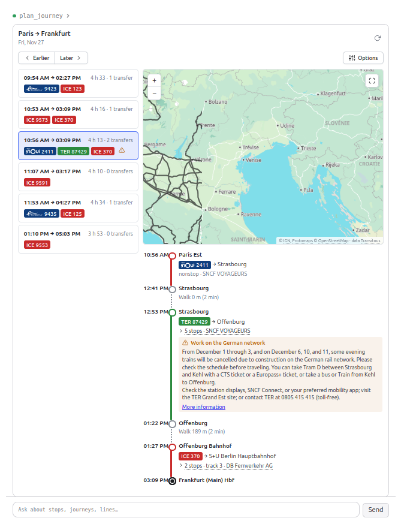
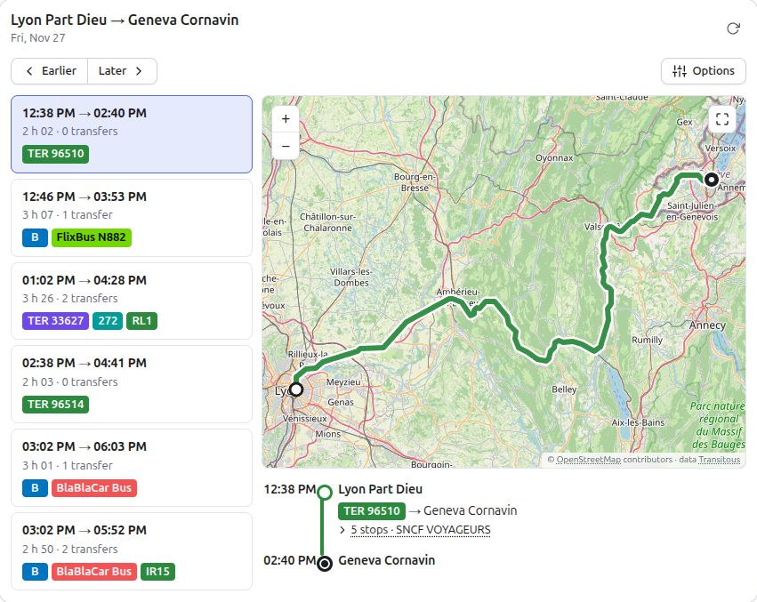
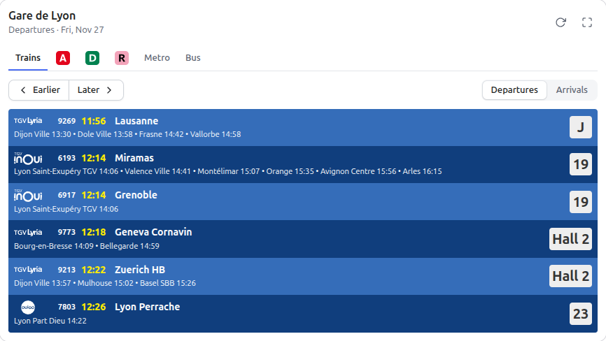
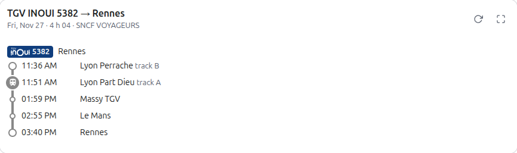
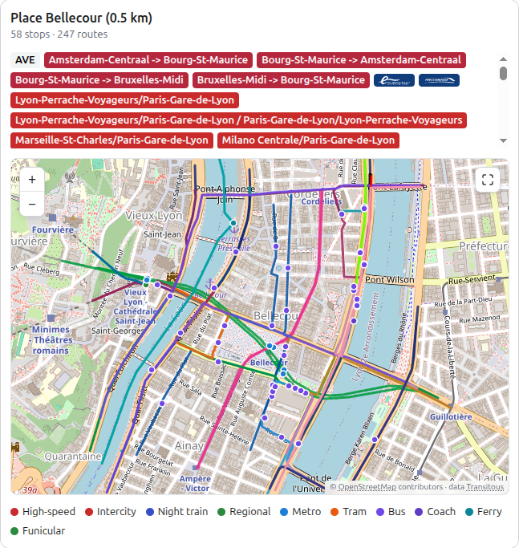
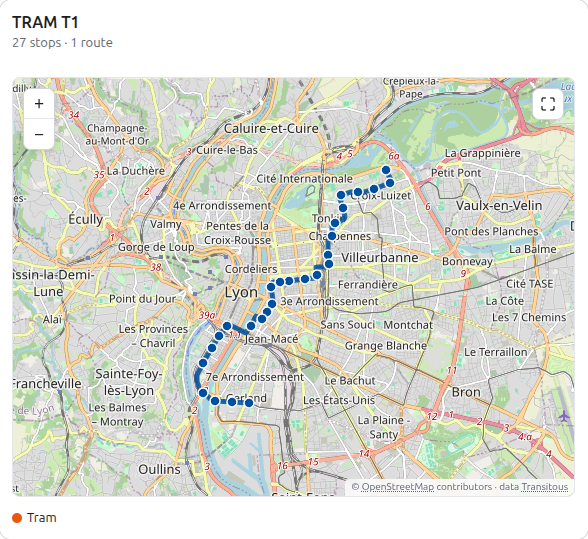
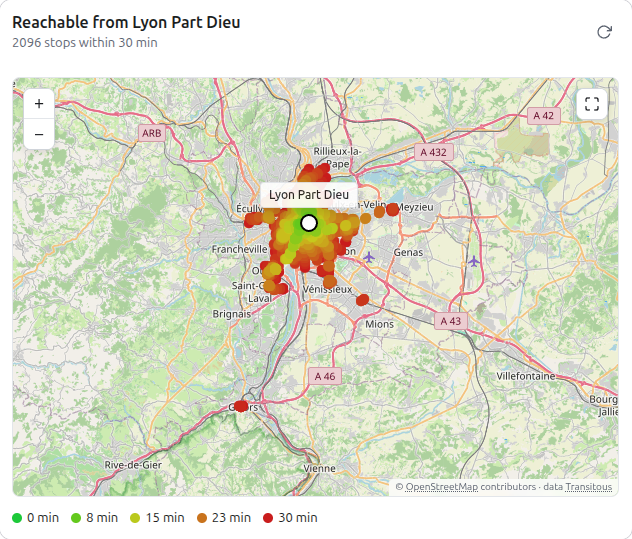
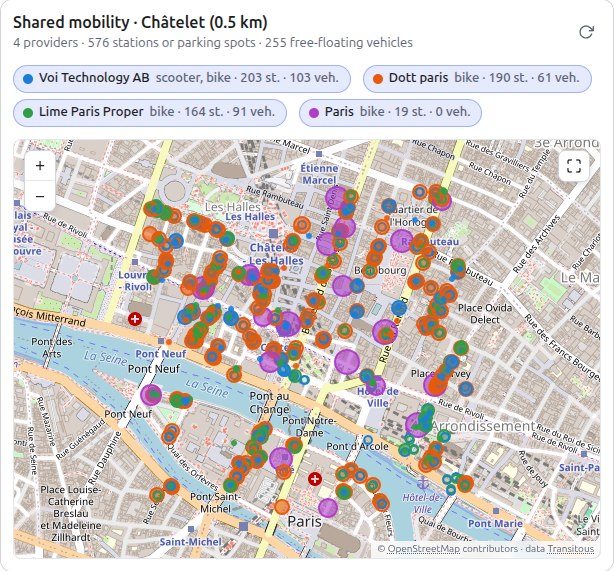

#  Errance: MCP server and MCP App to explore public transport

[](https://github.com/Litote/motis-mcp-app/actions/workflows/ci.yml)
[](https://sonarcloud.io/summary/new_code?id=Litote_motis-mcp-app)
[](https://sonarcloud.io/summary/new_code?id=Litote_motis-mcp-app)

[MCP server](https://modelcontextprotocol.io) and [MCP App](https://modelcontextprotocol.io/extensions/apps/overview)
to explore the public transport data of a [MOTIS](https://github.com/motis-project/motis) server: by default
[Transitous](https://transitous.org/), which aggregates open GTFS, GTFS-RT and GBFS feeds worldwide. Journeys,
departure boards and maps are shown in interactive views in the hosts that support MCP Apps; the other hosts get the
text.

## Quick start

### Local server (Docker)

```bash
# any MCP client, with add-mcp
npx add-mcp "docker run -i --rm -e MOTIS_APP_CONTACT=you@example.org ghcr.io/litote/motis-mcp-app" --name errance
```

`MOTIS_APP_CONTACT` (e-mail address) is required by the [Transitous usage policy](https://transitous.org/api/).


### Hosted server

The server runs at `https://errance.litote.org/mcp` (Streamable HTTP, no account needed).

**Any MCP client** (Claude Code, Cursor, VS Code, Codex, Gemini CLI…), with [add-mcp](https://add-mcp.com):

```bash
npx add-mcp https://errance.litote.org/mcp --name errance
```

## Demo

The [demo site](https://errance.litote.org/) is a static web chat. Users bring their own [OpenRouter](https://openrouter.ai) account (free models are available, 50 requests a day
without credits), and everything runs in the browser.

<p align="center">
  
</p>

More in the [demo FAQ](DEMO.md).

## Views

Each tool with a view renders it in the hosts that support MCP Apps, in the language of the host.

### Journey: `plan_journey`

The connections on the left, with their times, duration, transfers and the badges of their lines; the legs of the
selected connection on the map, and its detailed itinerary (stops, operators) below. Earlier and Later load the
neighbouring connections; Options sets the transit modes, the transfers, the walking time and speed, wheelchair and bike.

<p align="center"></p>

### Departure board: `departures`

The next departures or arrivals of a stop, in real time (delays, cancellations, tracks). In a railway station, a tab per
line or mode of the station (trains, RER, metro, bus…); the trains are shown in the style of the boards of the operator
when there is one (SNCF, SNCB, SBB, DB, NS, RFI, ADIF, National Rail).

<p align="center"></p>

### Trip timeline: `trip_details`

The stops of a vehicle, with their times and tracks, and its current position along the line.

<p align="center"></p>

### Area: `explore_area`

The stops and the lines around a place, colored by mode, with the list of the lines above the map.

<p align="center"></p>

### Line: `route_details`

The path of a line and its stops.

<p align="center"></p>

### Isochrone: `reachability`

The stops reachable by public transport from a place within a travel time, colored by the time to reach them.

<p align="center"></p>

### Shared mobility: `rentals`

The stations and free-floating vehicles (bikes, scooters, cars) around a place, by provider.

<p align="center"></p>

## Documentation

[MCP server reference](docs/MCP-SERVER.md): the tools, the configuration and the setup of the MCP clients

## Contributing

See [CONTRIBUTING.md](CONTRIBUTING.md): structure of the project, tests, quality, commit conventions and release.

## License

This project is licensed under the [GNU Affero General Public License](LICENSE).
